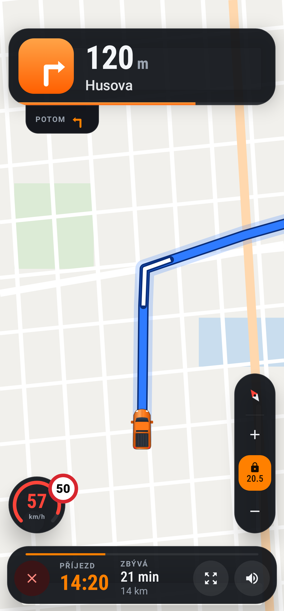
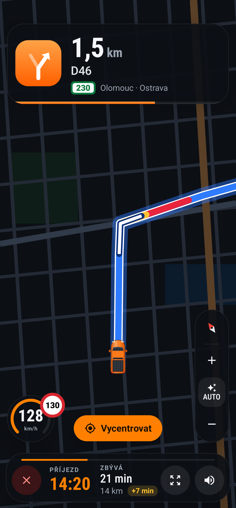
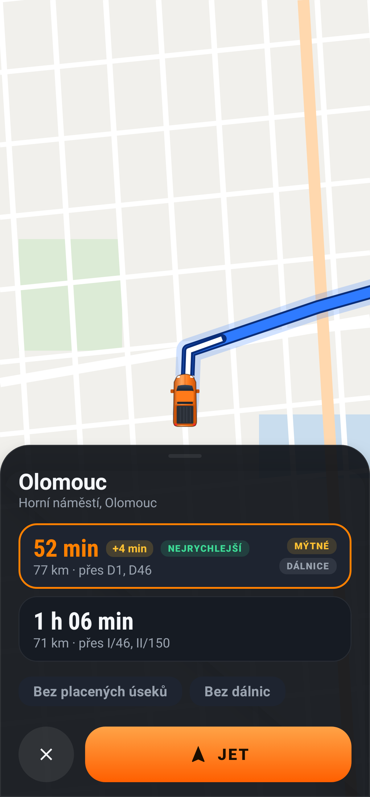
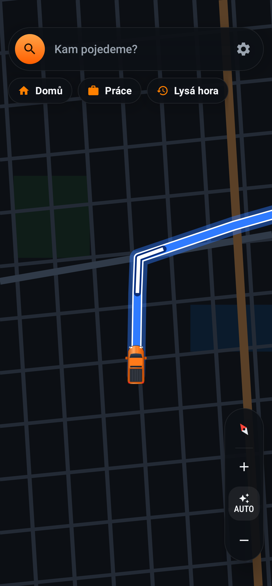

# Navigace – navigace pro telefon a Android Auto

Česká turn-by-turn navigace pro Android a **Android Auto** postavená na otevřených datech (OpenStreetMap).
Hlavní důvod existence: **zoom, který si nastavíš, platí napořád.** Žádné automatické oddalování,
žádné „po 5 sekundách zpátky“. Když dáš max zoom, zůstane max zoom.

| Navigace ve městě | Dálnice v noci + doprava | Náhled tras | Výchozí obrazovka |
|---|---|---|---|
|  |  |  |  |

> Screenshoty jsou skutečné Compose komponenty vyrenderované v Robolectricu
> (`./gradlew :app:testDebugUnitTest`). Mapa pod nimi je jen ilustrace – MapLibre potřebuje GPU.

## Funkce

| Oblast | Co umí |
|---|---|
| **Zámek zoomu** | Zoom nastavený gestem nebo +/− se zamkne a přežije jízdu, manévry, posun mapy, vycentrování, přepočet trasy i restart appky. Telefon a auto mají každý svůj zámek. Menu: *Auto* / *Zamknout aktuální* / *Max zoom napořád*. |
| Trasy | Valhalla: nejrychlejší trasa + až 2 alternativy, vyhýbání dálnicím, mýtu a trajektům |
| Navádění | Velký banner (vzdálenost, ulice, výjezd + směr), „Potom…“ u rychle navazujících manévrů, kruhové objezdy s číslem výjezdu |
| Hlas | Česky přes TTS, časování podle **rychlosti** (ne fixních metrů), audio focus pro navigaci (hudba se jen ztlumí) |
| Přepočet trasy | Detekce sjetí z trasy s hysterezí (GPS glitch ≠ sjetí), detekce jízdy v protisměru, přepočet s ohledem na směr jízdy |
| Rychlost | Tachometr s prstencem k limitu + česká značka limitu (data OSM), červený při překročení |
| **Živá doprava** | TomTom: kolony obarvené přímo na trase, provoz na mapě, čas s dopravou v náhledu, hlášení „zdržení asi 15 minut“ |
| **ETA** | Časy routeru × doprava × naučené tempo jízdy (viz níže) – už ne nadsazené |
| Poloha | Vlastní ukazatel (oranžový pickup), plynulá animace 60+ fps, auto ve **spodní třetině** obrazovky, ve stoji se nehýbe |
| Vzhled | „Telemetrický“ HUD: tmavé skleněné panely, papaya akcent, zúžené číslice, vlastní styl mapy s 3D budovami, zářící trasa, šipka manévru přímo v křižovatce |
| Vyhledávání | Photon (autocomplete), Domů / Práce / Nedávné, „Navigovat sem“ z jiných aplikací (`geo:` URI) |
| Android Auto | Vlastní mapa na ploše auta, šablony navigace / náhledu / vyhledávání / oblíbených, údaje pro přístrojový štít (cluster/HUD), „Ok Google, naviguj do…“ |
| Ostatní | Den/noc, mapa po směru jízdy / sever nahoře, foreground služba s notifikací, **simulace jízdy** pro testování |

## Zámek zoomu – jak funguje

Logika je v čistém Kotlinu: [`CameraController`](core/src/main/kotlin/cz/fenixen/navigation/core/navigation/CameraController.kt) (pokrytá testy).

```
ZoomPolicy = Auto | Locked(zoom)

gesto / +/− při sledování auta ─▶ Locked(z)  ──▶ uloží se do DataStore
posun mapy (FREE)               ─▶ zoom při prohlížení zámek NEMĚNÍ
vycentrovat / nová trasa        ─▶ vrací se na Locked(z)
jen tlačítko AUTO               ─▶ Auto (zoom podle rychlosti + přiblížení před manévrem)
```

Kamera je jen **stavový automat**, který vydává příkazy (`Follow`, `Fit`, `ZoomTo`). MapLibre adaptér je jen
vykonává. Díky tomu stejná logika řídí telefon i Android Auto a dá se testovat bez emulátoru.

## Živá doprava (TomTom)

Valhalla dopravu nezná, proto se k ní přidává TomTom v režimu *route reconstruction*: pošle se mu naše trasa
a vrátí aktuální čas jízdy, zdržení a úseky s kolonou přesně na ní.

1. Zdarma účet na [developer.tomtom.com](https://developer.tomtom.com) → *API Keys* (free tier 2 500 dotazů/den,
   dlaždice provozu mají vlastní limit).
2. V appce *Nastavení → Živá doprava → TomTom API klíč*.
3. Během navigace se doprava obnovuje každé 3 minuty (≈ 20 dotazů/hod jízdy).

Bez klíče appka funguje dál, jen bez dopravy.

## Proč už ETA není nadsazené

[`EtaEstimator`](core/src/main/kotlin/cz/fenixen/navigation/core/navigation/EtaEstimator.kt) násobí časy routeru dvěma korekcemi:

- **doprava**: (čas TomTomu s provozem) / (čas Valhally) pro zbytek trasy. Opraví i celkovou „opatrnost“ Valhally,
- **tempo**: jak dlouho ti ujetá část reálně trvala vs. předpověď. Náběh je postupný, krajní hodnoty jsou ořezané
  a čekání před rozjezdem se nepočítá. Jako když inženýr upravuje odhad stintu podle prvních kol.

## Používám Dijkstru?

Krátce: **Dijkstra je základ, ale v reálné navigaci se samotný nepoužívá.** Na celé ČR (miliony křižovatek)
by trasa Praha → Ostrava „usadila“ skoro celý graf. Projekt proto obsahuje vlastní implementace a jejich
srovnání ([`core/.../graph`](core/src/main/kotlin/cz/fenixen/navigation/core/graph)):

| Algoritmus | Ø usazených uzlů | Ø čas dotazu | Princip |
|---|---:|---:|---|
| Dijkstra | 45 360 | ~6,5 ms | „Koule“ kolem startu, roste podle vzdálenosti |
| A* | 16 274 | ~3,3 ms | Dijkstra + odhad zbytku (přímá vzdálenost / max rychlost) |
| Obousměrný Dijkstra | 26 518 | ~4,5 ms | Dvě menší koule ze startu a z cíle |
| **Contraction Hierarchies** | **118** | **~0,08 ms** | Předzpracování: zkratky přes „nedůležité“ uzly, dotaz jde jen „nahoru“ |

*Syntetická silniční síť 300×300 (90 000 uzlů, ulice / okresky / dálnice), 300 náhodných dotazů,
`./gradlew :core:routingBenchmark`. Všechny algoritmy vrací stejné délky tras (checksum + testy proti Dijkstrovi).*

Analogie z F1: Dijkstra je jako plánovat kolo zatáčku po zatáčce po celém okruhu včetně boxové uličky.
CH je inženýr, který předem ví, že rozhodující jsou tři sektory, a mezi nimi už jen „skáče“ po zkratkách.
Cena: předzpracování (tady 10 s, pro ČR minuty) a změna vah (doprava) znamená nové předzpracování.
Proto Google & spol. používají **CRP / Customizable CH**, kde se metrika přepočítá za sekundy.

**V aplikaci** se trasy počítají serverem **Valhalla** (obousměrné A* nad hierarchickými dlaždicemi grafu).
Vlastní engine je připravený jako offline varianta (rozhraní `RoutingProvider`), chybí mu ale
načítání OSM dat (viz *Další kroky*).

## Architektura

```
:core  (čistý Kotlin/JVM – žádný Android, rychlé testy)
 ├─ geo/          GeoPoint, haversine, Polyline (kumulativní vzdálenosti, projekce), polyline codec
 ├─ model/        Route, Maneuver, Place, LocationFix …
 ├─ routing/      RoutingProvider (port) + ValhallaRoutingProvider (adaptér) + rychlostní limity
 ├─ search/       Geocoder + Photon, parser geo: URI
 ├─ navigation/   NavigationSession (stavový automat), RouteProgressTracker, AnnouncementPlanner,
 │                CameraController (zámek zoomu)
 ├─ graph/        RoadGraph (CSR), Dijkstra, A*, obousměrný Dijkstra, Contraction Hierarchies
 └─ simulation/   RouteSimulator (virtuální jízda)

:app   (Android)
 ├─ AppGraph       ruční DI – jedna NavigationSession pro telefon I auto (stejný proces)
 ├─ map/           NavMapController (MapLibre adaptér), ikony manévrů
 ├─ ui/            Jetpack Compose (Material 3)
 ├─ service/       foreground služba typu location
 ├─ voice/         TTS + audio focus
 ├─ location/      Fused Location + LocationCoordinator (GPS jen když je potřeba / simulace)
 └─ car/           Android Auto: CarAppService, šablony, CarMapRenderer (VirtualDisplay + Presentation)
```

Klíčová rozhodnutí:

- **Jediný zdroj pravdy:** `NavigationSession` vystavuje `StateFlow<NavigationState>`. Telefon, auto,
  notifikace i hlas jen poslouchají. Navigaci spuštěnou v telefonu auto okamžitě převezme a naopak.
- **Ports & adapters:** jádro nezná Valhallu ani MapLibre, jen rozhraní (`RoutingProvider`, `Geocoder`,
  `CameraCommand`). Výměna routeru = jedna třída.
- **Sledování trasy:** okénkové hledání (O(okno), ne O(trasa)), skóre vzdálenost + rozdíl kurzu
  (dálnice v protisměru), monotónní postup, hystereze sjetí z trasy.
- **Ikony manévrů** se kreslí programově (`Canvas`), jedna implementace pro telefon i `CarIcon`.

## Spuštění

Požadavky: Android Studio (aktuální), JDK 17+, Android SDK s platformou **37.2**.

```bash
./gradlew :app:installDebug          # nainstaluje do připojeného telefonu
./gradlew :core:test                 # testy jádra (algoritmy, tracker, hlas, kamera, parsery)
./gradlew :app:testDebugUnitTest     # screenshot testy UI → app/build/outputs/roborazzi
./gradlew :core:routingBenchmark     # srovnání algoritmů
```

### Android Auto

1. Na telefonu v aplikaci **Android Auto** → Nastavení → 10× klepnout na *Verze* → vývojářská nastavení
   → zapnout **Neznámé zdroje** (aplikace mimo Play Store se jinak v autě nezobrazí).
2. **Desktop Head Unit** (bez auta): SDK Manager → *Android Auto Desktop Head Unit Emulator*,
   v Android Auto vývojářském menu *Spustit server hlavní jednotky*, pak
   `adb forward tcp:5277 tcp:5277 && $ANDROID_HOME/extras/google/auto/desktop-head-unit`.
3. V nastavení appky zapni **Simulace jízdy**. Auto pak „jede“ po trase a uvidíš navádění, hlas
   i zámek zoomu bez řízení. (Funguje i *autodrive* v DHU.)

Ovládání v autě: mapová lišta **posun · + · − · zámek/AUTO** (po posunu mapy se ze zámku stane
„vycentrovat“). Každé +/− při sledování auta zoom zamkne. Max zoom = mačkat +, dokud to jde.

## Vlastní server tras na Raspberry Pi (doporučeno)

Veřejný server FOSSGIS je skvělý na testování, ale má limity a žádné SLA. Valhalla pro ČR v pohodě
běží na Pi 5 (8 GB):

```bash
# Na Pi (Docker). Stáhne extrakt ČR z Geofabriku a postaví dlaždice (první běh desítky minut).
docker run -dt --name valhalla --restart unless-stopped -p 8002:8002 \
  -v $HOME/valhalla:/custom_files \
  -e tile_urls=https://download.geofabrik.de/europe/czech-republic-latest.osm.pbf \
  ghcr.io/valhalla/valhalla-scripted:latest

# HTTPS přes Tailscale (platný certifikát, žádný cleartext v Androidu):
sudo tailscale serve --bg 8002
```

V appce: Nastavení → *Server tras* → `https://<jméno-pi>.<tailnet>.ts.net`.
Před použitím si ověř, že image má build pro arm64 (případně ho postav ze zdrojáků).

## Známá omezení a další kroky

Poctivě, co **není** hotové:

- **Ověřeno jen buildem, testy a screenshoty, ne na reálném zařízení ani v DHU.** Nejrizikovější místa:
  vykreslování mapy přes `Presentation` na ploše auta a sledování kamery v MapLibre. Otestuj nejdřív v DHU.
- **Doprava potřebuje TomTom klíč** (zdarma, ale vlastní účet). Parser odpovědi je otestovaný podle dokumentovaného
  formátu; proti živému API kvůli chybějícímu klíči ověřený není.
- Nové vykreslování (vlastní kamera, pickup) je ověřené buildem a screenshoty, ne na zařízení.
- **Jízdní pruhy** (lane guidance) zatím ne. Valhalla je umí vrátit ve formátu OSRM, je to další krok.
- **Offline:** mapy se jen cachují (MapLibre ambient cache). Vlastní CH engine potřebuje importér OSM PBF → grafu.
- Pro český hlas musí být v telefonu nainstalovaný český TTS hlas (Google TTS → Čeština).
- Car App Library 1.7: `RoutePreviewNavigationTemplate` je deprecated, ponecháno kvůli autům s host API < 7.

Atribuce: mapová data © přispěvatelé [OpenStreetMap](https://www.openstreetmap.org/copyright) (ODbL),
dlaždice [OpenFreeMap](https://openfreemap.org), trasy [Valhalla](https://github.com/valhalla/valhalla),
vyhledávání [Photon](https://photon.komoot.io).
